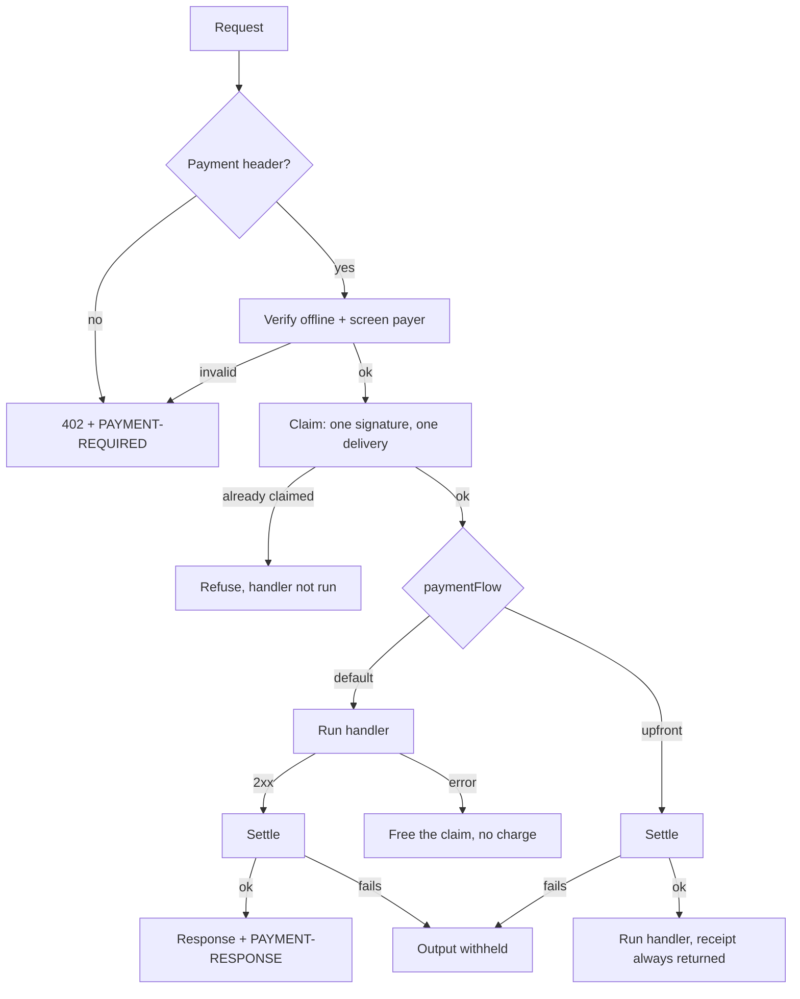

# quebracho/x402

[x402](https://www.x402.org/) payments for PHP: sign and verify payments, a
PSR-15 middleware for sellers and a PSR-18 client for buyers. No framework. MIT.

**TL;DR**

- **Sell:** a PSR-15 middleware (`X402Middleware`) or an MCP one
  (`X402McpMiddleware`) answers `402`, verifies the payment offline, runs your
  handler once per payment and settles through a facilitator.
- **Buy:** `PayingHttpClient` / `PayingMcpClient` pay a `402` once, inside a
  per-network budget.
- **Safe by default:** OFAC screening is on, a replayed payment never runs your
  handler, mock mode exists only by name.
- **Chains:** EVM (EIP-3009), Solana; NEAR and Casper are experimental.

## Install

```bash
composer require quebracho/x402
```

Needs PHP 8.3+, `ext-gmp`, `ext-sodium`, any PSR-7/17 implementation (e.g.
`nyholm/psr7`) and, for buying, any PSR-18 client.

Upgrading from 0.3: read [UPGRADE.md](UPGRADE.md) (OFAC screening is now on by default).

## Sell

```php
use Quebracho\X402\{EvmExact, FileClaims, Networks, X402Middleware};

// Price per request: a list of offers, or null when it is free.
$price = fn ($request) => [Networks::requirements('eip155:84532', '0.01', $payTo)];
$middleware = new X402Middleware([new EvmExact()], $price, $claim, $psr17, $psr17, $settle);
```

Unpaid → `402` with `PAYMENT-REQUIRED`. Paid → verify offline, claim, run the
handler, settle only on 2xx, answer with `PAYMENT-RESPONSE`. `$claim` makes each
payment buy one delivery (`(new FileClaims('/var/x402-claims'))(...)` on one
host, or any atomic `fn(string $key): bool`); `$settle` is a facilitator
callback, and `Settlement::mock()` is mock mode (real verification, nothing
moves).



Everything else about selling is in [docs/seller.md](docs/seller.md): the
optional hooks, the payment ledger and its reconciler, events and logs,
facilitators (generic, Circle, your own chain), MCP and job mode.

## Buy

```php
use Quebracho\X402\{Budget, EvmExact, PayingHttpClient, Signer};

$client = new PayingHttpClient(
    $psr18,   // must not follow redirects
    [new EvmExact(new Signer($testnetKey))],
    Budget::usd('eip155:84532', '0.05'),
);
```

It pays a `402` once and retries. For MCP use `PayingMcpClient`. Budget,
allowlist of sellers and timeouts: [docs/buyer.md](docs/buyer.md).

## Guides

| Guide | What is in it |
|---|---|
| [docs/seller.md](docs/seller.md) | hooks, payment ledger, events and logs, facilitators, MCP, job mode |
| [docs/buyer.md](docs/buyer.md) | budget, seller allowlist, timeouts |
| [docs/networks.md](docs/networks.md) | built-in networks, adding an EVM chain |
| [docs/screening.md](docs/screening.md) | OFAC (on by default), more lists, listeners |
| [docs/protections.md](docs/protections.md) | what is checked, layer by layer, and the known limits |
| [docs/near.md](docs/near.md), [docs/casper.md](docs/casper.md) | the experimental schemes |
| [UPGRADE.md](UPGRADE.md), [ROADMAP.md](ROADMAP.md) | moving between versions, what comes next |

## Networks

Built in: the demo testnets (Base Sepolia, Arc testnet, Ethereum Sepolia,
Avalanche Fuji, Polygon Amoy, Solana devnet), **Arc mainnet** (`eip155:5042`)
and **Ethereum mainnet** (there to be *read*: the blacklist check is free;
settling there costs real gas). Any EVM chain whose token has
`transferWithAuthorization` is a `Networks::add(...)` away, see
[docs/networks.md](docs/networks.md).

## Schemes

`Scheme` (`supports`, `pay`, `verify`, `payer`) is one chain family; experimental
until 1.0.

- `EvmExact`: the stable one.
- `SolanaExact` (`solana:*`, devnet USDC built in): offline verification of one
  TransferChecked; smart wallets and lookup tables are refused. The offer needs
  `extra.feePayer` (`HttpFacilitator::feePayer`).
- `NearExact` (`near:testnet`): experimental, see [docs/near.md](docs/near.md).
- `CasperExact` (`casper:casper`, `casper:casper-test`): experimental, see
  [docs/casper.md](docs/casper.md).

## Frameworks without PSR-7

Drupal and Symfony speak HttpFoundation: bridge both ways with
`symfony/psr-http-message-bridge` and a PSR-17 factory. That buffers the body,
so streamed and file responses lose their laziness; fine for paid JSON or
Markdown. The steps are plain calls underneath (`Scheme::verify`,
`Settlement::key`, `Settlement::run`, a `Facilitator`), so a framework can
charge without PSR-15 too.

## Tests

```bash
vendor/bin/phpunit tests   # no network
```

See [NOTICE](NOTICE) for the origin of some classes.
