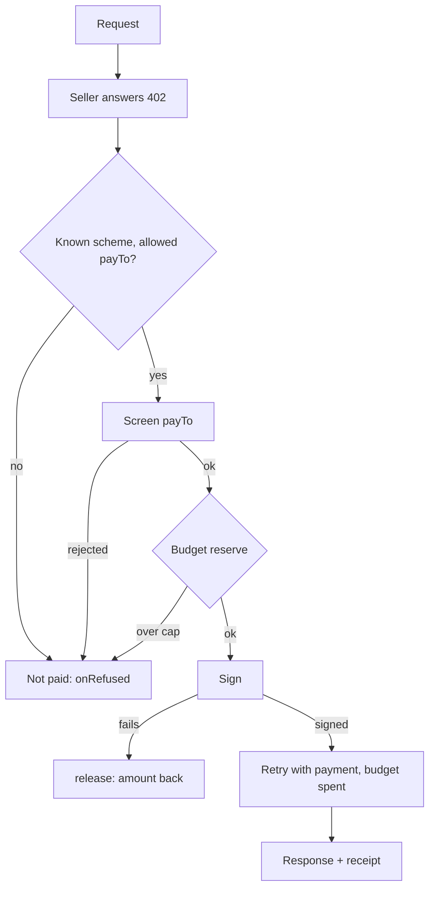

# Buyer

```php
use Quebracho\X402\{Budget, EvmExact, PayingHttpClient, Signer};

$client = new PayingHttpClient(
    $psr18,
    [new EvmExact(new Signer($testnetKey))],
    Budget::usd('eip155:84532', '0.05'),
);
```

For MCP, `new PayingMcpClient($psr18, $schemes, $budget, $psr17Streams, $onPaid)`
goes under the MCP client's HTTP transport instead: it pays a PaymentRequired
tool result once, resending the call with `params._meta["x402/payment"]`, and
reads the receipt from `result._meta["x402/payment-response"]`.



`PayingHttpClient` pays a 402 once and retries the same request. Wrap a client
that does not follow redirects, or another host gets the signed payment. The budget is a per-network cap,
in memory, spent when it signs (a signed authorization is money the seller
can settle) and never refunded on the seller's word. Both buyers sign only
known tokens (`Networks`), integer amounts and validities up to 10 minutes
(`Budget::fromUsd(..., maxTimeout: 170)` lowers that: never sign a validity
longer than your HTTP client waits).
With `Budget::usd($network, $usd, $used)`, where `$used` reads the token's
`authorizationState` on chain (`new AuthorizationState($http, $psr17, $psr17)`,
with a short timeout), a signature the seller never settled frees its amount
once it expires unused.

Concurrent payments in one process (Fibers, ReactPHP, Amp) share the same
`Budget` object, and the cap holds across them: `reserve()` checks the offer
and counts it in one step before signing, and `release()` gives it back if the
payment never left (a failed signature). The budget lives in that one process
only: separate processes, workers or hosts each have their own cap, so a
shared limit needs the app to store the spent totals itself.

`onRefused: fn(array $req, string $reason)` on both buyers says why an offer
was not paid (`no_scheme`, `not_allowed`, or the screening's reason). With
`$events`, both also report `PurchaseIntent`, `PurchaseOutcome` and
`BudgetReclaim` ([Events and logs](seller.md#events-and-logs)).

**Pay only the sellers you know.** `PayeeAllowlist`, an `AddressCheck`
listener, refuses every `payTo` not listed (`payto_not_allowed`); an empty list
pays nobody. Recommended for an agent: a listing it was shown (or a prompt that
reached it) cannot name its own wallet. OFAC still runs first.

```php
$dispatcher->addListener(AddressCheck::class, PayeeAllowlist::fromCsv(getenv('X402_PAYTO_ALLOW')));
```
PSR-18 has no per-request options: give the wrapped client a timeout longer
than the offers' `maxTimeoutSeconds` plus the seller's settle (e.g. 120 s), or
a buyer that hangs up early may be charged for an answer it never reads.
