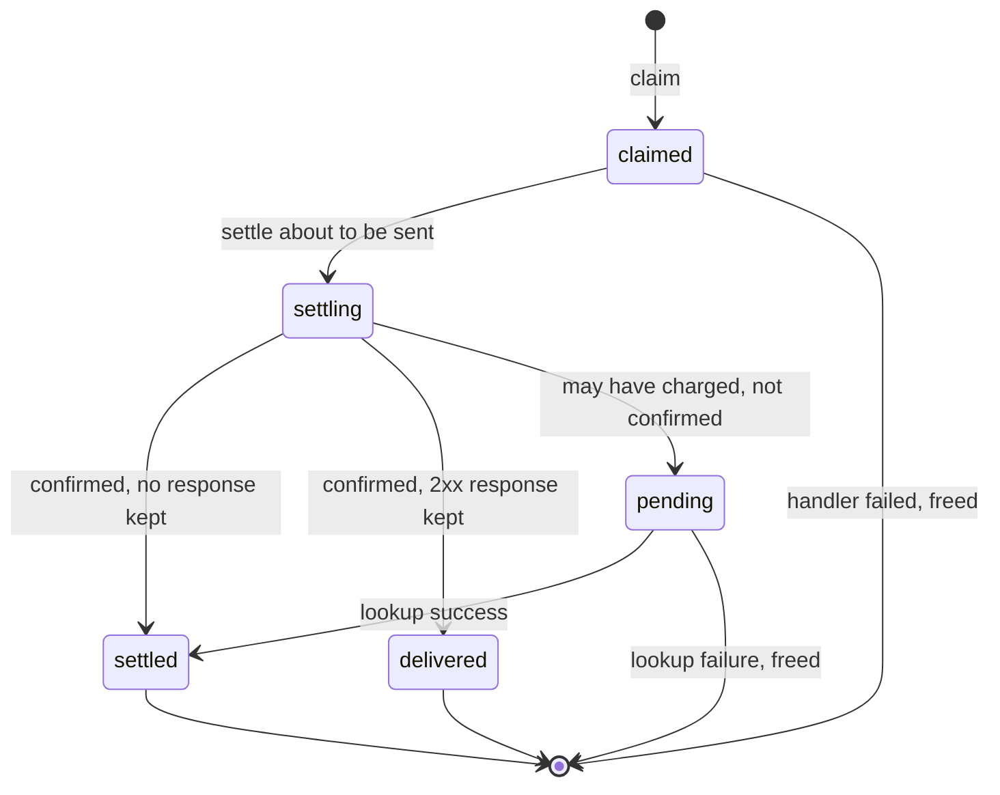
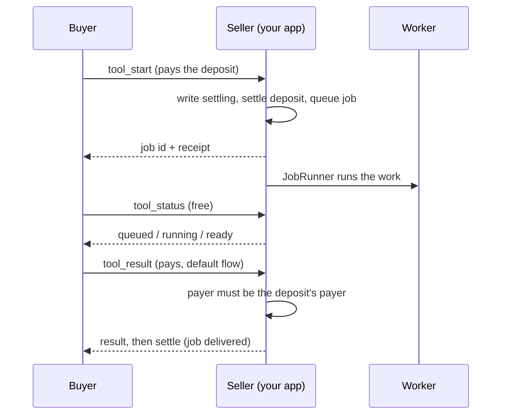
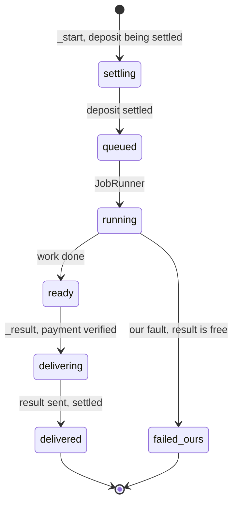

# Seller

```php
use Quebracho\X402\{EvmExact, FileClaims, Networks, X402Middleware};

// Price per request: a list of offers, or null when it is free.
$price = fn ($request) => [Networks::requirements('eip155:84532', '0.01', $payTo)];
$middleware = new X402Middleware([new EvmExact()], $price, $claim, $psr17, $psr17, $settle);
```

`$claim` makes each payment buy one delivery, even before it settles:
`(new FileClaims('/var/x402-claims'))(...)` on one host, or any atomic
`fn(string $key): bool` (DB unique key, Redis `SET NX`) on several. To keep
more than the claim (the stored response, pending settles), pass a ledger: see
[Payment ledger](#payment-ledger).

Unpaid → `402` with `PAYMENT-REQUIRED`. Paid → verify offline, claim, run the
handler, settle only on 2xx, answer with `PAYMENT-RESPONSE`. `$settle` is a
facilitator callback; `Settlement::mock()` is mock mode, by name only: real
verification, nothing moves on chain, the receipt says `extensions.mock`.

Optional, by name, on both middlewares:

- `verify:` `fn($payment, $req): ?string`, an online check (`$facilitator->verify`)
  before the claim: an empty wallet runs nothing and takes no claim. Return
  `NULL` when the payment is good, or a non-empty reason string. Any other
  return (`''`, `false`, an array) or any exception refuses as
  `unexpected_verify_error`; a `FacilitatorException` stays `facilitator_unavailable` (502).
- `release:` `$claims->release(...)`: a payment that charged nothing (handler
  failed, settle failed with no transaction) is good again. A pending settle
  keeps its claim. `FileClaims::prune($seconds)` clears old claims.
- `resource:` the 402's `resource` (canonical URL, description, mimeType).
- `extra.paymentFlow = 'upfront'` in an offer settles **before** the handler
  runs. **Use it for any handler with an effect you cannot undo** (create an
  order, call a paid third-party API, issue a credential, publish, start a job):
  in the default flow the handler runs before settle, so if the settle then
  fails the buyer got the effect without paying. Once money moved, the receipt
  goes with whatever the handler answers; a handler that then fails records
  `failed_after_settle` so you can refund by hand. Default flow is for
  content-like output, where withholding the response is the whole delivery.
- A `FacilitatorException` answers 502 on HTTP (`facilitator_unavailable` on MCP).
  On settle the claim is kept: the facilitator may have sent the transaction.
- A tool result with `isError` is not charged and goes out as it is: a paid
  tool must not put what it sells in its errors.
- `$events` also receives a `PaymentOutcome` (settled, not_settled, failed,
  rejected, failed_after_settle) per paid request; its `error` holds the
  exception behind a reason (verify or settle that threw, facilitator down,
  a ledger that refused a write), for logs only. A listener that throws cannot
  undo a sale. The other events are in [Events and logs](#events-and-logs).

## Payment ledger

`PaymentLedger` keeps each payment's state across requests and processes, by
name on both middlewares. It replaces `$claim` and `$release` (the signature
still takes `$claim`; it is not used then):

```php
use Quebracho\X402\{EvmExact, FileLedger, X402Middleware};

$middleware = new X402Middleware([new EvmExact()], $price, $claim, $psr17, $psr17, $settle,
    ledger: new FileLedger('/var/x402-ledger'),   // one host; several hosts need a shared store
    lookup: $lookup,                              // optional, see "pending" below
    sensitive: $sensitive,                        // optional: fn(request|params): bool, keep the state, never the body
);
```

A request `sensitive` marks (or one whose check throws) is delivered, but its
body is never stored: a retry after it settled gets `already_settled`, not a
replay.

`claim($key, $ttl)` must be atomic (of N concurrent calls exactly one returns
TRUE); `get`, `put` and `release` complete the state part of the interface.
`open`, `openKeys` and `close` keep an index of open payments: every
`settling` or `pending` state is opened (with the network, payer, nonce, payTo,
amount, validBefore and any transaction or `paymentId`, never a signature or a
body) for three days, and `settled` or `delivered` closes it, so a reconciler
can walk them (`openKeys($limit)`) and ask the chain. `FileLedger` is one
host: one JSON file per key, plus one `.open` file per open entry. A store that cannot answer throws
`LedgerUnavailableException`, and nothing is charged: before the handler runs,
HTTP answers `503 ledger_unavailable` and MCP answers the PaymentRequired with
`error: ledger_unavailable` in-band.



- **States.** `claimed` (in progress: a retry gets `409 in_progress`);
  `settled` (charged, no response kept: `409 already_settled`); `delivered`
  (charged, the 2xx response kept: a retry gets it again, not run again, with
  the receipt); `pending` (may have charged, not confirmed: see below).
- **Written before the money or the handler moves (write-ahead).**
  `settling` is stored before a settle is sent. `handling` is stored before an
  upfront handler runs, and it is closed by `delivered`, or by `settled` with
  `handler_ran: false` when the handler answered non-2xx or threw, or on MCP
  answered `isError` or a JSON-RPC error (a retry runs it again, as before). If the store refuses the `settling` write, nothing is
  sent: `503 ledger_unavailable`. Refused on the `handling` write, the handler
  does not run.
- **A retry that finds an open intention.** `settling` without a transaction or
  `paymentId` in its receipt: `409 settlement_unknown` (no settle, no handler).
  With one, the lookup decides: confirmed settles it (an upfront handler then
  runs once), refuted frees it, unknown answers `409 settlement_unknown`.
  `handling` without a kept response: `409 needs_review` (MCP: `isError` with
  `needs_review`). The handler is never run again by the middleware: a person
  decides. A `handling` with a kept response is replayed.
- **Residual window.** A crash while a settle request is in flight, or a store
  failure when the outcome is written, leaves `settling` with no reference (the
  transaction or `paymentId` exists only once the facilitator answers). It
  answers `409 settlement_unknown` until its TTL frees the claim. After that the
  retry goes through verify again: if the settle did happen, the token rejects
  the spent nonce, so nothing is charged twice, but the buyer paid and got no
  response, and nothing tells the seller on its own. `ChainFacilitator` closes
  it: its transaction is stored in `settling` before it is sent (pass
  `$chain->settle(...)` as `$settle`), and a store that refuses that write sends
  nothing (`503 ledger_unavailable`).
- **What is kept.** Only a 2xx response of at most 1 MiB, base64 in the state.
  Its TTL is `min(600, validBefore − now)` (24 h for a `settling` or `pending`
  state with a transaction); each state expires with it.
- **The store is read only after the signature verifies offline**: the nonce
  is public, so anyone can copy a payment, and a forged copy costs no read.
- **Pending.** A settle that may have charged and is not confirmed (its claim
  kept) is asked of `lookup(array $state): ?array` when the buyer retries: a
  receipt with `success: true` settles it (the response is then replayed), one
  with `success: false` frees it (the retry runs as new), `NULL` (or a lookup
  that throws) keeps it pending and answers `409 settlement_pending`.
- **A failed store after a settle does not become an error.** If a
  `LedgerUnavailableException` comes when the outcome is stored after a
  successful settle, the response still goes out: the money has moved. The claim
  stays until its TTL, so the buyer cannot pay twice. A `PaymentFault` with op
  `record` says so: a person (or the reconciler) looks.

Ready-made pieces, all PSR-18 + PSR-17:

- `RedisLedger('redis://host:6379')` (ext-redis): one ledger for several hosts.
  Claims are `SET NX EX`, so one payment is delivered once across hosts. A Redis
  that does not answer is `ledger_unavailable`; never fall back to `FileLedger`
  then. Run Redis with `maxmemory-policy noeviction` and `appendonly yes`.
- `ReceiptLookup($paymentStatus, $http, $psr17, $psr17)` is a `lookup`: an EVM
  transaction is confirmed by its receipt and the asset's `AuthorizationUsed`
  log for this payer and nonce; a `paymentId` by the facilitator's `/status`
  (`PaymentStatus`: Circle's; `null` asks only the chain). Any failure is
  `NULL`, still pending.
- `Reconciler($ledger, $http, $psr17, $psr17)->reconcile($limit)`, from cron
  every few minutes: walks the open entries and asks the chain
  (`authorizationState`, then the `AuthorizationUsed` log). An authorization used
  is written `settled`; one unused and expired is freed. It never charges nor
  runs a handler. It returns one row per entry; log the `needs_review` and
  `rpc_error` ones, a person resolves those. EVM (EIP-3009) only.

## Events and logs

Every event is PSR-14 and only reports: a listener that throws changes no
answer. Pass the dispatcher as `$events`.

| Event | Side | When |
|---|---|---|
| `PaymentIntent` | seller | before a settle is sent or an upfront handler runs (a crash after it still leaves a line) |
| `PaymentOutcome` | seller | once per paid request: settled, not_settled, failed, rejected, failed_after_settle |
| `PaymentFault` | seller | the ledger could not do something and the sale went on: `record` (the state after a settle was lost: needs a person), `intend`, `release`, `release_run`, `close`, `lookup` |
| `AddressRejected` | both | the screening refused an address; `error` when a list threw |
| `ScreeningSkipped` | both | a list built with `failOpen: true` could not answer, so the address passed it unchecked |
| `PurchaseIntent` | buyer | a payment is signed and about to be sent; its `key` is the seller's ledger key |
| `PurchaseOutcome` | buyer | per offer: paid, refused, released (the signature failed), unsettled |
| `BudgetReclaim` | buyer | `reclaim()` asked the chain about an expired signature: freed, used, unknown |

None of them holds a signature or a response body. `error` fields may hold
internals: logs only.

`PaymentLog($psr3Logger)` writes one line per event, at a level that says how
urgent it is (`failed_after_settle` and a lost `record` are errors).
`PaymentLog::events()` maps each event class to its method, to subscribe them
all at once. `PaymentRecord($dir)`, a `PaymentOutcome` listener, appends one
JSON line per sale or failed settlement to `$dir/<YYYY-MM>.jsonl`, files kept
and never rotated: what moved money, or should have.

```php
$log = new PaymentLog($logger);
foreach (PaymentLog::events() as $event => $method) {
    $dispatcher->addListener($event, [$log, $method]);
}
$dispatcher->addListener(PaymentOutcome::class, new PaymentRecord('/var/lib/x402/records', $logger));
```

## Facilitators

`$settle = fn ($payment, $req) => $facilitator->settle($payment, $req);` with
any `Facilitator` (all PSR-18 + PSR-17):

- `new HttpFacilitator($http, $psr17, $psr17, 'https://x402.org/facilitator', $bearer)`:
  the generic client, any x402 facilitator by URL with an optional bearer key
  (`verify`, `settle`, `supported`, `feePayer()` for Solana). A settle counts only when consistent: 2xx, `success: true`, a
  transaction, our network, the payer who signed. Verified on Base Sepolia.
  The crash window between the send and the answer stays open with HTTP
  facilitators (this one and Circle's): they give no reference before they answer.
- Circle: `new CircleFacilitator($http, $psr17, $psr17, $bearer, $seller)`
  (URL `CircleFacilitator::URL`), with an API key (`$bearer`), or keyless
  with the payTo key (`$seller` signs the seller proof). A pending settle is
  polled at `/status` by its `paymentId`; only this one has that route
  (`PaymentStatus`). Still pending after polling, it answers
  `settlement_pending` with that `paymentId`, which the ledger's lookup uses.

  Migrating from 0.1.x: `HttpFacilitator::CIRCLE` is a deprecated alias of
  `CircleFacilitator::URL`, kept so old code still compiles. Through
  `HttpFacilitator` that URL is verify and settle only: keyless Circle needs the
  seller proof and the `/status` poll, which only `CircleFacilitator` sends.
  Move those callers to `new CircleFacilitator(...)`.

  Migrating from 0.2.x: `HttpFacilitator` keeps the v0.2.1 argument order
  (`$bearer`, `$seller`, `$pollDelaySeconds`, `$pollAttempts`) as a shim, and the
  seller proof headers and the `/status` poll keep working through it. The new
  optional `$headers` hook comes last. Passing `$seller` raises
  `E_USER_DEPRECATED`; `$seller`, `$pollDelaySeconds` and `$pollAttempts` are
  removed in the next major version (1.0). Use `new CircleFacilitator(...)`
  instead, which sends the same proof and polls the same way.
- `new ChainFacilitator(new Rpc(...), $gasWallet, 'eip155:5042002', $lock)`:
  no third party; simulates with `eth_call`, sends `transferWithAuthorization`
  from a gas wallet, waits for the receipt (`settlement_pending` keeps the hash).

Configure the PSR-18 client not to follow redirects, so the signed payment
reaches only the facilitator you named.

## MCP

For an MCP server over Streamable HTTP, `X402McpMiddleware` follows the
official [x402 MCP transport](https://github.com/x402-foundation/x402/blob/main/specs/transports-v2/mcp.md):
an unpaid `tools/call` gets `isError` + PaymentRequired, the payment comes in
`params._meta["x402/payment"]`, the receipt in `result._meta["x402/payment-response"]`.

```php
$price = fn (array $params) => $params['name'] === 'wisdom' ? [Networks::requirements(...)] : null;
$middleware = new X402McpMiddleware([new EvmExact()], $price, $claim, $psr17, $psr17, $settle);
```

Optional hooks, each off by default (a tool that does not use them is sold
exactly as without them):

- `validate: fn(array $params): ?string` runs before any payment is read; a
  reason is a JSON-RPC `-32602` error and nothing is claimed, settled or run.
  `$price` returning NULL means *free*, so it cannot be the validation.
- `payer: fn(array $params, string $payer): ?string` runs once the signature
  proved who pays, before the claim: the reason it returns is the
  PaymentRequired's `error` (your own code; for example, only the payer who
  started a job may buy its result). A scheme that cannot name the payer is
  `invalid_payload`.
- `duration: fn(array $params): int` is the tool's worst case in seconds from
  the claim until the settle is sent. An EVM signature whose `validBefore`
  leaves less than that plus `EvmExact::SLACK` (6 s), on `EvmExact`'s clock, is
  refused right after the offline verify (no facilitator round trip) and again
  just before the claim, once the online verify took its time
  (`invalid_exact_evm_payload_authorization_valid_before`,
  the spec's code: here "too short for this tool"); a scheme
  without `validBefore` is refused (`unsupported_scheme`) when a duration is
  declared. Give that tool a longer `maxTimeoutSeconds`
  (`Networks::requirements(..., $timeout)`).

Upfront over MCP: once the money moved the receipt always goes back, in
`result._meta["x402/payment-response"]`, or in
`error.data["x402/payment-response"]` when the tool answered with a JSON-RPC
error (a scalar `data` is kept under `data.data`).

## Job mode

A work that takes minutes (a model, a render) is sold in two payments: a
`<tool>_start` call takes a deposit upfront and queues the work, a free
`<tool>_status` says when it is ready, and a `<tool>_result` call buys the
result in the default flow (settled once it is delivered). The protocol is in
[`docs/job-mode.md`](https://github.com/quebracho-digital/quebracho-x402-mcp/blob/main/docs/job-mode.md).
The library holds its state machine and the pieces that do not depend on a
framework, under `Quebracho\X402\Job`:



| Piece | What it is |
|---|---|
| `Job` | one job, immutable: `settling > queued > running > ready > delivering > delivered`, or `failed_ours` (our fault, by a closed list: the result is then free). Each transition is checked against `Job::TRANSITIONS`; the buyer's input is dropped once the work ran |
| `JobStore` | where jobs live: atomic, serialised writes; `create` is idempotent on the deposit's `Settlement::key`. `FileJobStore` is one host (flock, rename, files 0600) |
| `JobWork` | the work one `_start` tool sells: `check()` before any payment is read, `refuse()` before the deposit settles, `run()` |
| `JobRunner` | runs a queued job once the `_start` response went out (after the response, or from a queue worker) |
| `JobStatus` | what `_status` answers, the same for a stranger's job as for none |
| `JobPayments` | how a job's payment ended when its request is gone: the ledger first, then `authorizationState` |
| `JobReconciler`, `JobJanitor` | from cron: move on the jobs a lost answer left waiting, give up on stale work, forget results and buyer text after their TTLs |



The hooks that tie the middleware to these pieces are in the library too:

| Piece | What it is |
|---|---|
| `JobDesk` | the four hooks `X402McpMiddleware` calls (`validate`, `payer`, `sensitive`, `settle`), routed by the tool's role, and `afterResponse()` |
| `JobDeposit` | a `_start`: the work's check before any payment is read, a free slot and the `settling` row before the deposit moves, the job queued after, run once the response went out |
| `JobDelivery` | a `_result`: only the deposit's payer, only a ready job, `ready > delivering > delivered`; the free re-read; and `_status` |
| `JobIdOnRefusal` | a PSR-15 middleware, right outside `X402McpMiddleware`: a `_start` refused once its job exists still answers the jobId, to the deposit's payer only |
| `JobSlots` | how many jobs run at once. `FileJobSlots` is one host (flock); adapt your own lock service in a few lines |

```php
$jobs = [
    'report_start' => ['role' => 'start', 'pairedWith' => 'report_result', 'price' => '0.01'],
    'report_result' => ['role' => 'result', 'pairedWith' => 'report_start', 'price' => '0.05'],
];
$prices = new PriceList('eip155:8453', $payTo, '0.01', jobs: $jobs);
$store = new FileJobStore($dir.'/jobs');
$desk = JobDesk::for($jobs, $store, new JobRunner($store, [$work]),
    new FileJobSlots($dir.'/slots', 2), $ledger, $facilitator, $prices(...));

$mcp = Seller::with($schemes, $desk->settle(...), $psr17, $psr17)
    ->ledger($ledger)
    ->sensitive($desk->sensitive(...))
    ->mcp($prices, validate: $desk->validate(...), payer: $desk->payer(...));

// after the response went out (Symfony: kernel.terminate; PHP-FPM: after fastcgi_finish_request()):
$desk->afterResponse();
```

What stays with your app: the three MCP tools, each one line over the desk
(`$desk->deposit->queue()`, `$desk->delivery->deliver()`, `$desk->delivery->status()`),
the cron that calls `JobJanitor` and `JobReconciler`, and the call to `afterResponse()`.
`tests/Job/JobFlowTest.php` runs the whole flow with three such tools; the demo app in
the same organisation wires it into Symfony.
